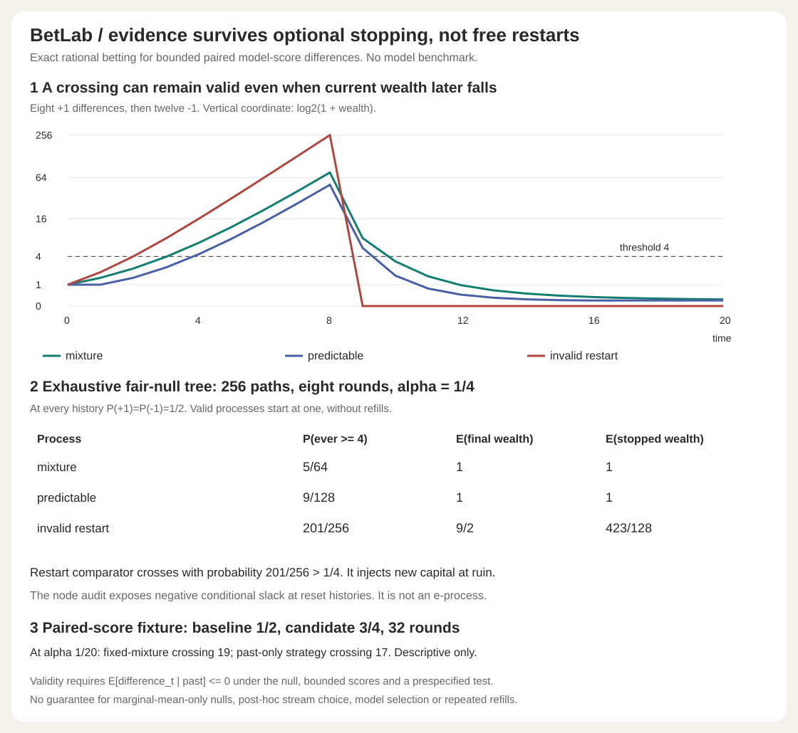

# BetLab

Exact sequential evidence for bounded paired model scores, with an exhaustive audit of what goes wrong when ruined tests get free restarts.



BetLab is a dependency-free Python 3.10+ implementation of standard nonnegative betting processes. It reports every rational wealth update, mixture component, past-only bet, first threshold crossing and running-maximum p-value bound. A separate finite-law auditor enumerates all branches and checks conditional expectations, stopped wealth and the exact probability of ever crossing.

This is an offline statistical-mechanics project for AI evaluation. It does not train a model or claim a new inference theorem. The paired-score examples and null trees are developed fixtures, not untouched benchmarks or deployed monitoring evidence.

## Run

```bash
python -m betlab demo
python -m betlab replay examples/replay-input.json
python -m betlab paired examples/paired-input.json
python -m betlab tree examples/tree-input.json
python -m unittest discover -s tests -v
python examples/render_demo.py --check
```

No API key, data download, third-party runtime dependency or paid service is needed. `pip install .` installs the importable package. The four CLI commands emit complete JSON; invalid input exits 2 with empty stdout.

```python
from betlab import paired, replay, audit_tree, coin_tree

result = paired(["1/2"] * 32, ["3/4"] * 32)
print(result["decisions"]["mixture"]["first_crossing"])  # 19
law = audit_tree(coin_tree(8), alpha="1/4")
print(law["summary"]["invalid_restart"]["crossing_probability"])  # 201/256
```

## The statistical contract

Let `D_t = candidate_score_t - baseline_score_t`, with both scores in `[0,1]`. The single one-sided null is **`E[D_t | past] <= 0` at every round**, with `D_t` in `[-1,1]`. Higher scores must be better. Data order, scoring rule, compared models, stream, mixture and test must be selected before inspecting the tested data. Predictability is relative to the available past; no current or future observation may enter a bet.

For any past-measurable `b_t` in `[0,1]`, start at one and multiply by `1+b_t*D_t`. Factors are nonnegative. Under the conditional null, their conditional expectations are at most one, so wealth is a nonnegative supermartingale. A fixed convex mixture of such wealth processes is another. Ville's inequality bounds the probability of **ever** reaching `1/alpha` by alpha. An arbitrary stopping time is allowed within this fixed test. Selecting the winning test after running several is not covered.

BetLab exposes two valid constructions separately:

- `mixture`: fixed bets `[0,1/4,1/2,3/4,1]`, equal positive weights by default. Caller-supplied distinct bets and exact positive normalized weights are supported. Components retain their own capital, including permanent ruin at zero. Their maximum is not substituted for their average.
- `predictable`: the past-only heuristic `clip(sum_previous_D / (1 + sum_previous_D_squared), 0, 1)`. The current observation is excluded. It has the same validity argument, not a power-optimality claim. It is a separate test, not an extra component chosen after seeing results.

For each valid process, `anytime_p_bound = min(1, 1/running_max_wealth)`. It is not a posterior probability of the null, an effect-size estimate, a confidence interval or proof that a particular model is generally better. Non-crossing is not evidence of equivalence. A crossing remains recorded if wealth later falls.

**The guarantee is conditional on the assumptions, not certified from an observed sequence.** Marginal mean zero alone is insufficient. Correlation is allowed only when the conditional-null condition remains true with the relevant information. Repeatedly reusing a benchmark, choosing a model on the same stream, inspecting both valid tests and selecting the winner, searching over streams, resetting capital after failure or changing hypotheses require additional design or multiplicity accounting not supplied here. No arbitrary-dependence, drift, model-selection or production guarantee is claimed.

## Exact developed controls

At alpha `1/4`, the full fair-coin null tree has eight rounds, 255 internal histories and 256 equiprobable leaves. Each node has conditional mean zero.

| Process | Probability of ever reaching 4 | Expected final wealth | Expected wealth stopped at crossing or leaf |
|---|---:|---:|---:|
| Fixed mixture | 5/64 | 1 | 1 |
| Past-only strategy | 9/128 | 1 | 1 |
| Invalid free restart | 201/256 | 9/2 | 423/128 |

The invalid comparator uses bet one and injects a fresh unit **before the next round whenever wealth is zero**. The chance of at least one run of two positive signs in eight fair flips is `201/256`, far above `1/4`. It is not a valid e-process; the node audit exposes negative conditional expectation slack after ruin. This is a counterexample to free refills, not to optional stopping.

The six-round negative-drift tree has positive-sign probability `1/3` and conditional mean `-1/3`. Crossing probabilities are `1/81` for both valid constructions and `281/729` for the invalid restart. No Monte Carlo estimate enters these tables.

A reversal sequence has eight `+1` differences followed by twelve `-1`. Both valid processes first cross threshold four at round four, then end below four. The history is not erased. A separate 32-round paired fixture with baseline `1/2` and candidate `3/4` crosses threshold twenty at round 19 for the mixture and 17 for the past-only heuristic. These are descriptive fixture results, not a ranking of general test power.

Full reproducible summary: [examples/demo.json](examples/demo.json). Full fair-null node/leaf audit: run `tree examples/tree-input.json`. [Proof, schema and boundaries](DESIGN.md).

## Verification

34 tests include independent exhaustive product references for all 243 length-five ternary sequences; a separate 64-path crossing/expectation reference; exact fair and negative-drift trees; predictable-prefix checks; all 256 observations and 16 mixture components; zero wealth; equality at threshold; running p-bound monotonicity; a marginal-zero but conditionally invalid law; variable-depth/zero-difference controls; internal rational differences larger than input component caps; alias/cycle/scope/input guards; and all four CLI outputs and error paths.

SVG tests check all 63 plotted coordinates, all nine null-table values, full compressed report metadata, hidden-witness tampering and byte-exact regeneration. CI runs Python 3.10-3.13, reproduces demo JSON/SVG and checks the installed wheel's four full CLI JSON outputs outside the checkout.

## Attribution and limits

The mathematics is established. The implementation and tests here are from scratch, not a claim of inventing betting or anytime-valid inference. The core reference is [Waudby-Smith and Ramdas, Estimating means of bounded random variables by betting](https://academic.oup.com/jrsssb/article/86/1/1/7043257), especially the capital-process and predictable-betting arguments. Supporting references: [mean/variance e-processes and discrete mixtures](https://arxiv.org/html/2301.12480v7), [formal bounded-mean betting theorem documentation](https://robby955.github.io/FormalSLT/FormalSLT/AnytimeValid/BettingCS.html), [Ville inequality context](https://arxiv.org/html/2304.01163), [Ji Won Park's tutorial](https://jiwoncpark.github.io/posts/2025/02/estimation-as-betting/) and [Oxford reading-group notes](https://shirleyliuxq.github.io/Ramdas_Wang_ebook_chapter7-2.pdf). Referencing formal theorem documentation does not formally verify this Python code.

The tree audit proves arithmetic for a supplied bounded finite law only. No unbounded-score method, confidence-sequence inversion, learned optimal bet, automatic stream selection, multiple-test correction, persistent online service or actual model deployment is included. Exact rational arithmetic has bounded input domains and can grow expensive; no throughput claim is made.
